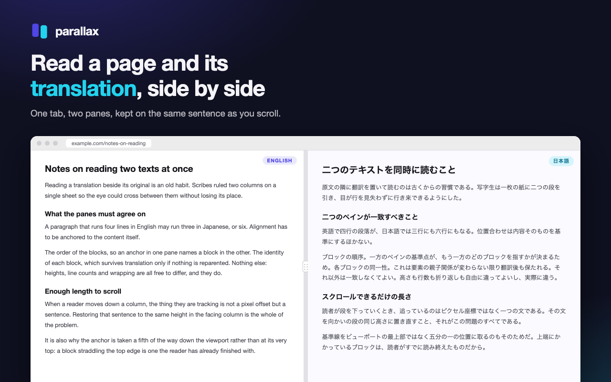
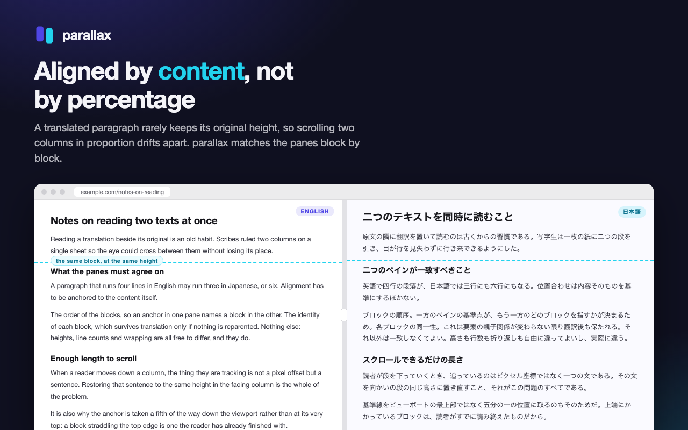
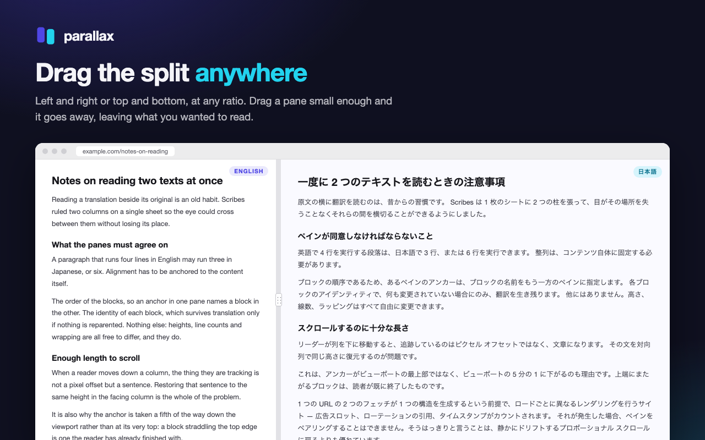
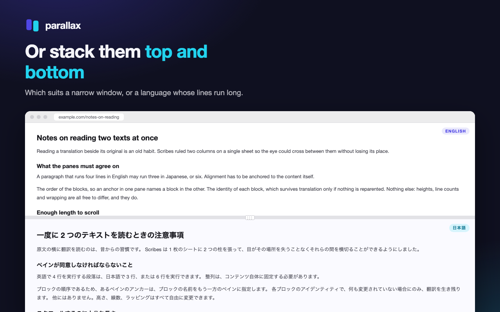

# parallax

Read a page and its translation side by side, in the same tab.

Two panes of the same page, one as published and one translated in place, kept on the same
sentence as you scroll. Translation runs on your own machine through Chrome's built-in
Translator API: no API key, no account, nothing sent anywhere, and it works offline once the
language pack is downloaded.



## What it does

- **Splits left/right or top/bottom**, at whatever ratio you drag the divider to. Drag a pane
  small enough and it goes away, ending the split — dragging away the translation puts you
  back on the original page at the offset you left it; dragging away the original leaves the
  translation full width to read.
- **Keeps the panes on the same sentence.** A translated paragraph rarely occupies its
  original height, so scrolling the two in proportion drifts. The panes are matched block by
  block instead, by what they say, and the follower is scrolled to bring the matching block
  to the same place on screen.

  

- **Translates what is on screen first.** The on-device translator runs one call at a time, at
  roughly 29 ms each. Working front to back would leave a long article untranslated for
  twenty seconds; ordering by what is in view makes the wait the length of one screen.
- **Reads sites that refuse to be embedded**, if you allow it, one site at a time. See
  [PRIVACY.md](PRIVACY.md#sites-that-refuse-to-be-embedded) for exactly what that changes.

| Any ratio | Or stacked |
|---|---|
|  |  |

## Requirements

Chrome 138 or later, on desktop. That is where the Translator API is available; it does not
exist on Android or iOS. The first use of a language pair downloads a language pack, which
Chrome does once and then keeps.

## Using it

Click the toolbar icon, choose the languages and the split direction, and press **Split this
page**. `Alt+Shift+P` opens the popup and `Alt+Shift+S` starts or stops a split; a shortcut
for flipping the direction can be assigned at `chrome://extensions/shortcuts`.

Esc closes the split. So does dragging the translated pane away.

## Known limitations

- **The panes are two more loads of the page.** In-page state — form input, an SPA's route,
  media playback — starts fresh inside them. The original page is untouched underneath and
  gets it all back when the split closes.
- **Following a link does not re-translate yet.** Both panes follow the link, but the new page
  arrives untranslated; press **Translate this page again** in the popup. Fixing the automatic
  path is the next thing on the list.
- **A link to another site ends the split**, returning you to the page you started from.
- **Sentences broken across `<a>` or `<strong>` translate as fragments**, because each text
  node is translated separately — which is what keeps the two panes structurally identical
  and therefore alignable.
- **Some sites will not load in a frame** for reasons no permission can change, and a few
  render differently on each load, which leaves fewer blocks to align on.

## Development

```sh
pnpm install
just build          # esbuild → dist/
just watch          # rebuild on change
just check          # biome + tsc --noEmit + vitest   (the gate before any commit)
just serve          # fixture pages on localhost:3000
just package        # parallax.zip for the Chrome Web Store

(cd video && pnpm install)   # once: the promo video has its own dependencies
just video-studio            # edit it in Remotion Studio
just video-render Promo      # video/out/Promo.mp4
```

Load `dist/` at `chrome://extensions` with developer mode on.

### Layout

| Directory | Contents |
|---|---|
| `src/shared/` | Pure functions only — no DOM, no `chrome.*`. Split geometry, scroll projection, alignment, failure descriptions |
| `src/content/` | The content script. The only place that touches a page, and where the Translator API is called — it is not available in a service worker |
| `src/chrome/` | Thin adapters over `chrome.*`, which is what lets `src/shared/` stay pure |
| `src/background/` | The service worker: keyboard commands and the framing override |
| `test/` | Mirrors `src/`. jsdom is opted into per file |
| `video/` | The store promo video, drawn with Remotion. Its scroll sync imports the anchor math from `src/shared/` rather than copying it |

Two invariants hold the design up. Translation only ever assigns `Text.data` — never inserts,
removes or reparents an element — which is what keeps the two panes alignable as it runs. And
failures are named rather than swallowed: every one has a code, copy in both locales, and a
test that the copy exists.

## Licence

[MIT](LICENSE).
